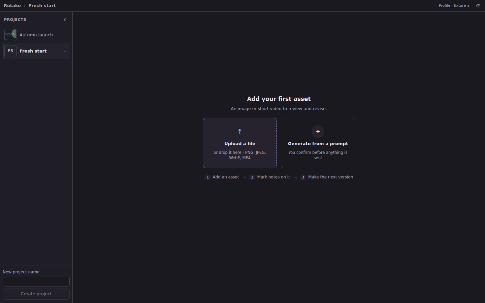
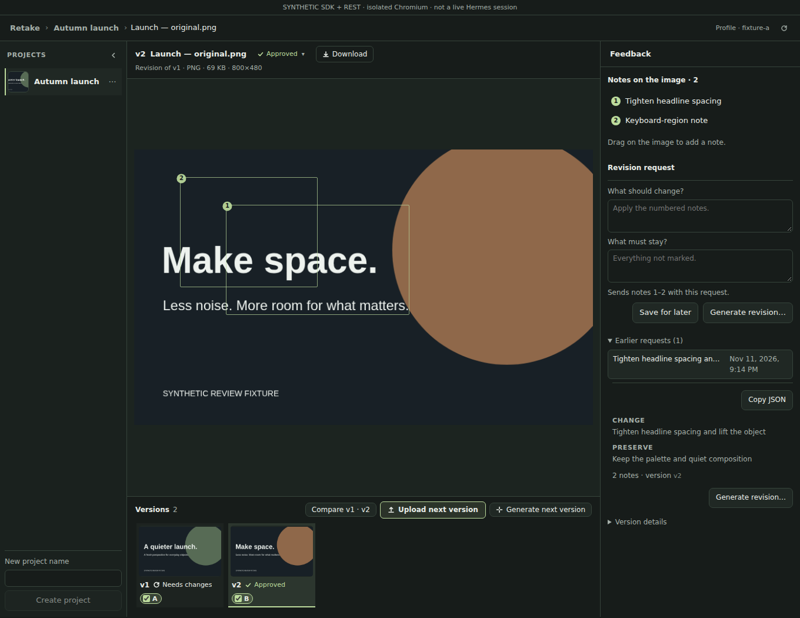

# Retake

**An image-generation workspace for Hermes Desktop: generate or upload an image, mark what should change, and make the next take without losing the original.**

Retake keeps image work in one place. Start with a generated image or one you upload, draw numbered notes on the regions you want changed, write what should change and what must stay, confirm a reference-guided revision, then compare versions side by side and download the one you want.

## From first image to next take

1. **Start with an image.** Describe one and generate it through Hermes's configured image tool, or upload a PNG, JPEG or static WebP.
2. **Point to the change.** Draw regions and add notes. Mark as many areas as the revision needs.
3. **Write the request.** Say what should change and what must stay. Saving notes or a request never starts a generation.
4. **Review, then generate.** Confirm once; Retake sends the exact stored parent image as the reference and stores the result as a new linked version.
5. **Compare and keep.** Compare two versions, mark each Approved, Needs changes or Rejected, and download any of them. Originals are never rewritten; rejected takes stay visible.

Projects, assets and versions are shown as a hierarchy you can navigate, and no chat needs to be open: generation runs from the Retake page.

## What it is not

- **Not a masked editor.** Region notes are text guidance sent with the reference image. Other parts of the image can change; pixel preservation is not guaranteed.
- **Not video generation.** Retake generates still images only. (Video generation is not part of this release.) The current release UI offers still-image upload only.
- **Not a model switcher on every Hermes.** A per-request model picker is optional and appears only when your Hermes exposes the image-selection listing. On stock Hermes v0.23.1 it is hidden and Retake uses your configured image tool.

## Requirements

- Hermes Desktop with a Hermes backend **v0.23.1 or newer** (`requires_hermes: ">=0.23.1"`; v0.23.1 is the oldest release Retake was tested against).
- A configured image-generation route in the Hermes profile you use, and for reference revisions an image tool that accepts an input image.
- The `mcp` extra of Hermes (Retake calls Hermes's standalone tool server).
- `image_generate` must not be hidden by tool search. With the default `tools.tool_search.enabled: auto`, stock Hermes hides it and Retake reports "Nothing was sent". Turn tool search off **for that profile only**:

  ```sh
  hermes -p <profile> config set tools.tool_search.enabled off
  ```

  This also makes every tool eager in that profile's chats. Retake never changes this setting itself.

Retake patches no Hermes core code and ships no runtime override. It uses the public plugin API, the Desktop plugin SDK and Hermes's public tool server.

## Install

Install straight from this repo (pin the commit you reviewed with `--ref`):

```sh
hermes plugins install wevial/retake
```

Once listed in the Hermes plugin catalog: `hermes plugins install retake`.

Then enable the plugin for your profile, rescan plugins in Desktop (**Settings → Plugins**), and open **Retake** in the sidebar. For a remote backend, install on that backend. Never copy credentials between machines.

## Your media, your provider account

Please read before generating.

- **Storage.** Projects, images, notes, requests and generation records live in the plugin's data folder of the active Hermes profile (SQLite plus image bytes). With a remote Hermes backend that is the **server**, not necessarily your laptop. Quotas: 512 MiB of media per profile.
- **What is sent.** A generation sends your prompt to the image provider configured in Hermes. A revision also sends the exact reference image and your saved change/preserve text and region notes.
- **Cost.** Generations may use provider credits or a subscription allowance. Cost and the exact model variant can be unknown; Retake records what the tool reports and does not verify it. Retake asks you to confirm before sending and **never automatically resubmits**. If the outcome is uncertain after the call was made, it is shown as "may have been billed", not retried.
- **Credentials.** Retake asks for no keys and does not read credential files. Provider access stays in Hermes.
- **Processes started by Retake.**
  - A child `python -m agent.transports.hermes_tools_mcp_server` for the requesting profile, called once per confirmed generation. It receives a copy of the backend's environment (including any provider variables Hermes already has), because that is how Hermes's own tool server finds its configuration.
  - If a provider returns its image as a temporary HTTPS URL (the stock Nous/FAL route does), a second short child downloads that one URL once through Hermes's public `agent.image_gen_provider.save_url_image`. It SSRF-checks each hop, caps redirects, and is bounded to 12 MiB and 60 s. Only `https:` results are accepted. Retake imports no other URL, accepts no user-supplied URL, and does not store or show the result URL. If the download fails, the attempt is recorded as failed and possibly billed, and is not retried. A Hermes without `save_url_image` keeps refusing URL results.
  - If available, a read-only listing child (`--list-image-selections`) powers the optional model picker.
- **Reads outside plugin data.** Only a generated file in the profile's own `cache/generated/images/` (or the file just downloaded there) is read after a generation. No server-path import exists.
- No telemetry, no self-updating code, no background jobs.

## Limits

PNG, JPEG, static WebP up to 12 MiB / 24 MP; 100 projects, 200 versions per project, 500 notes per version, 512 MiB per profile. Limits fail closed and never silently delete anything.

## Testing status (what was and was not checked)

- Plugin validator passes on an unmodified Hermes v0.23.1 export with no warnings (validator only), and the bundled offline tests pass against this exact package.
- Stock Hermes HTTP/API matrix: 86 tests run, 4 skipped.
- Native Mac Desktop: a build one step before this release was driven with real Nous generation, revision, Compare, Download and reload, and PNG/JPEG/WebP uploads plus next-version uploads were byte-exact. Management menus were only partly exercised. This release's UI changes (empty-project and asset-page layout) were verified offline and in a limited native check only; a full native pass of this exact build is **not** claimed.
- Real Nous preview HTTPS downloads through Hermes's `save_url_image` succeeded independently, but a live end-to-end run of Retake's own URL adapter was not performed.
- The optional model picker is hidden on stock Hermes v0.23.1. Masked editing and video generation are not offered.

## Screenshots

Synthetic browser previews with demo data (not native Desktop captures):




## Planned, not included

Video generation; sharper masked editing. Neither is available now and neither is promised.

## License

MIT. See [LICENSE](LICENSE).
