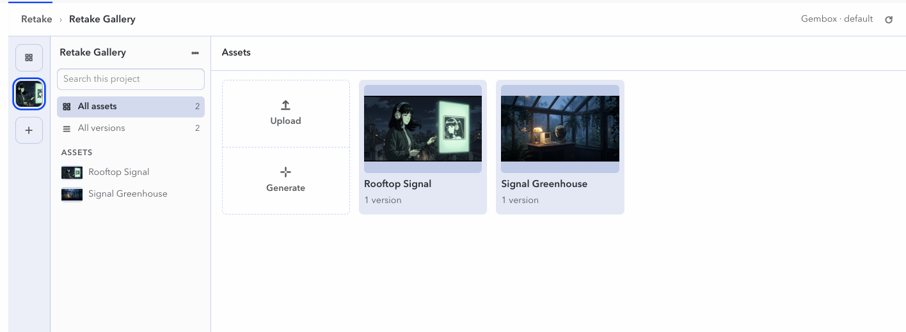
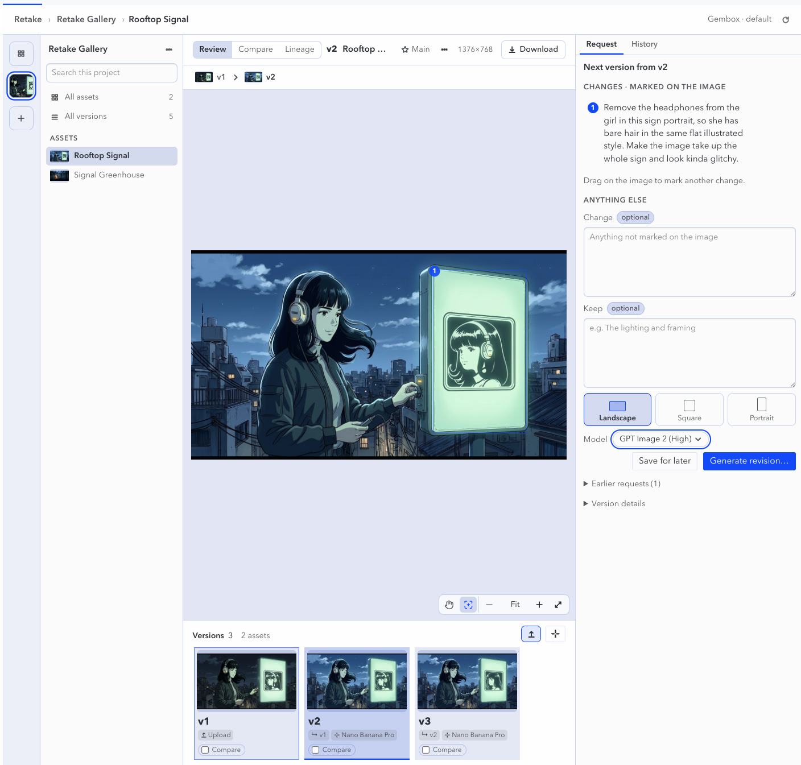
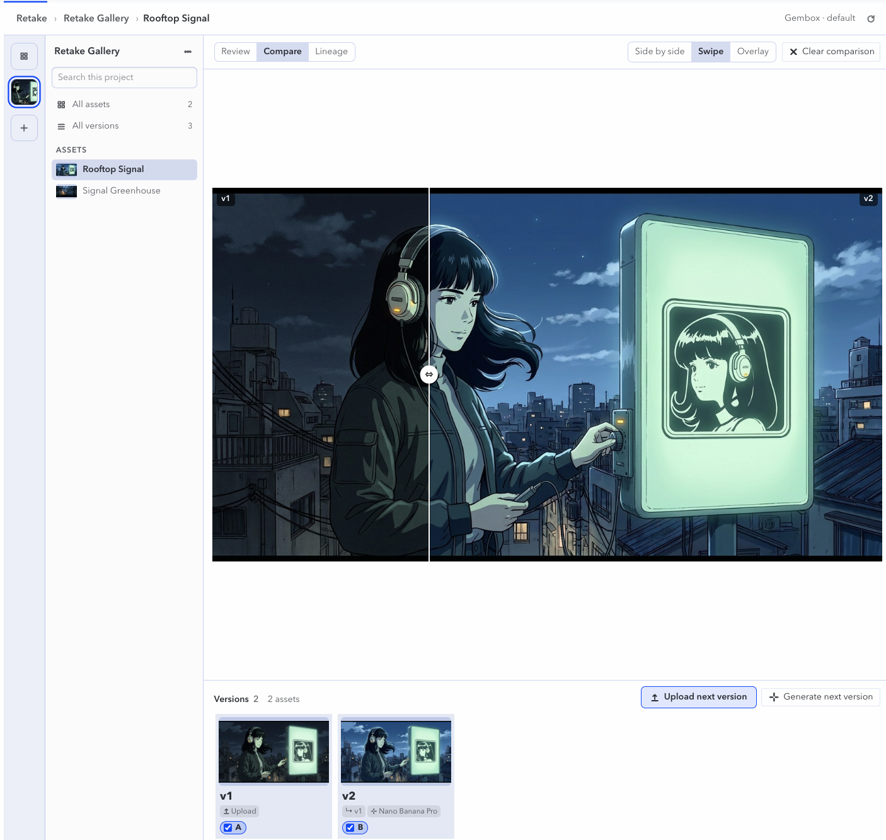
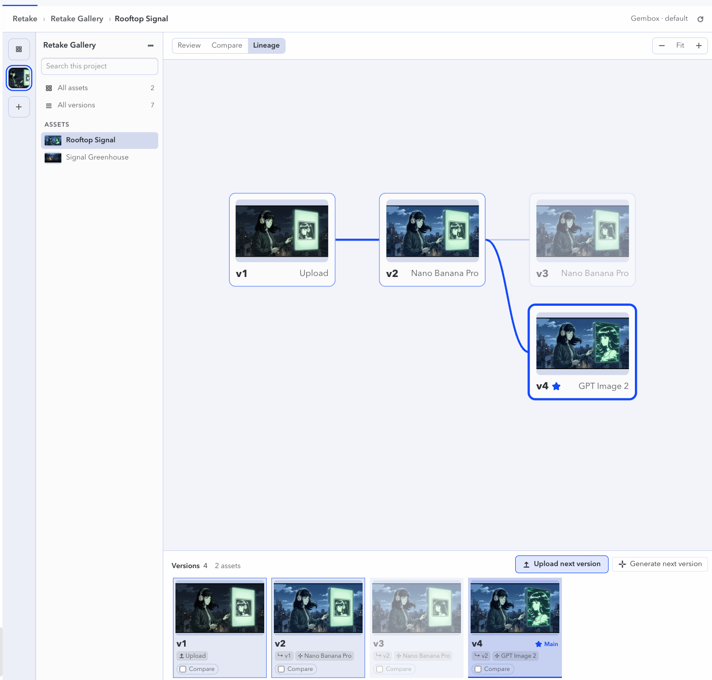

# Retake 0.4.1

**An image-generation workspace for Hermes Desktop: generate or upload an image, mark what should change, and make the next take without losing the original.**

Retake keeps image work in one place. Start with a generated image or one you upload, draw numbered notes on the regions you want changed, write what should change and what must stay, generate a reference-guided revision, then compare versions and download the one you want.

## From first image to next take

1. **Start with an image.** Describe one and generate it through Hermes's configured image tool, or upload a PNG, JPEG or static WebP.
2. **Point to the change.** Draw regions and add notes. Mark as many areas as the revision needs. Notes can be edited (**Save** / **Cancel**) or removed (with **Undo**).
3. **Write the request.** Say what should change and what must stay. Unsent text is kept per version when you leave Retake. Saving notes or a request never starts a generation.
4. **Generate.** The model, the account it bills and the charge note sit next to **Generate revision**. One click saves the request and sends it once; Retake sends the exact stored parent image as the reference and stores the result as a new linked version.
5. **Compare and keep.** Compare two versions side by side, follow an asset's history in **Lineage**, set one version per asset as **Main** (★), hide the ones you don't need, and download any of them. Originals are never rewritten; hidden versions are never deleted.

Projects, assets and versions are shown as a hierarchy you can navigate, and no chat needs to be open: generation runs from the Retake page.

## What it is not

- **Not a masked editor.** Region notes are text guidance sent with the reference image. Other parts of the image can change; pixel preservation is not guaranteed.
- **Not video generation.** Retake generates still images only, and this release offers still-image upload only.
- **Not a model switcher on every Hermes.** A per-request model picker is optional and appears only when your Hermes exposes the image-selection listing. On stock Hermes v0.23.1 it is hidden and Retake uses your configured image tool.

## What changed in 0.4.1

- **Generate revision sends from the request.** The separate confirm step is gone. Model, account (for example *Nous subscription*, or *Hermes configured provider* for the default) and "May be charged · cost unknown" are shown beside the button before you click. Opening the composer, changing the model or **Save for later** never sends anything; a double click still sends once.
- **First generation in an empty project** shows its progress in the centre (and its failure, until dismissed) instead of the start screen, then opens the new image.
- **Change / Keep text is kept** per version when you leave Retake or reload, until you save or generate the request. It is stored in Desktop's plugin storage on this computer, not in the project.
- **Attempt panel**: clearer state, time, model and account, the do-not-resubmit status, then actions. A reservation the page is sending reads **Starting…** without Run / Cancel reservation, and is sent without waiting for the board to refresh.
- **Version details** say "Not reported by Hermes" when the image tool did not report a provider or model (stock's FAL/Nous route does not).

## Upgrading

Existing **0.3.0 and 0.4.0 projects open unchanged** in 0.4.1. The SQLite schema, stored review values and API are unchanged from 0.4.0; 0.4.1 changes the Desktop page only. New features do not require changing existing projects.

## Requirements

- Hermes Desktop with a Hermes backend **v0.23.1 or newer** (`requires_hermes: ">=0.23.1"`; v0.23.1 is the oldest release Retake was tested against).
- A configured image-generation route in the Hermes profile you use, and for reference revisions an image tool that accepts an input image.
- The `mcp` extra of Hermes (Retake calls Hermes's standalone tool server).
- `image_generate` must be directly exposed by Hermes's standalone tool server. A configured provider can still be hidden by tool search: Retake then reports **"Nothing was sent"** before contacting a provider.

### Tool-search compatibility (per profile)

On Hermes versions with the `tools.tool_search.defer` list (verified on build `e93b3da`), remove **only** `image_generate` from that profile's effective list. Keep every other entry and leave tool search enabled. The supported commands below read the installed version's resolved schema/defaults, preserve a customized list's order and other entries, and fail before the setter if the value is not a list of strings. They require `python3`; replace `default` with the profile used by Retake, and run on that profile's **backend machine**:

```sh
profile=default
defer_json=$(hermes -p "$profile" config get tools.tool_search.defer --json) &&
defer_json=$(printf '%s' "$defer_json" | python3 -c 'import json,sys; v=json.load(sys.stdin); isinstance(v,list) and all(isinstance(x,str) for x in v) or sys.exit("Expected tools.tool_search.defer to be a list of strings; no change made"); print(json.dumps([x for x in v if x != "image_generate"]))') &&
hermes -p "$profile" config set tools.tool_search.defer "$defer_json"
```

Read back with `hermes -p "$profile" config get tools.tool_search.defer --json`: `image_generate` should be absent and all other entries unchanged. Do not paste a default list from another Hermes version over a customized list. Retake never changes these settings itself; the command is an explicit user action, not an installer step.

**Older Hermes versions:** the historical `tools.tool_search.enabled: off` workaround makes **every** tool eager in that profile. It is a broader, version-specific fallback for hosts without the supported deferral list, not the recommended change on current list-capable builds. If `config get` is unavailable or returns a non-list, stop and consult that installed Hermes version's configuration help rather than guessing or disabling tool search globally.

Retake patches no Hermes core code and ships no runtime override. It uses the public plugin API, the Desktop plugin SDK and Hermes's public tool server.

## Install

Install straight from this repo (pin the commit you reviewed with `--ref`):

```sh
hermes plugins install wevial/retake
```

Once listed in the Hermes plugin catalog: `hermes plugins install retake`.

Then enable the plugin for your profile, rescan plugins in Desktop (**Settings → Plugins**), and open **Retake** in the sidebar. For a remote backend, install on that backend. Never copy credentials between machines.

**Which backend.** Retake uses Desktop's active connection and profile, and names them at the right end of its breadcrumb row (for example `Studio · default`). Opening a chat on another machine moves Retake there too. If that connection has no Retake backend, Retake says so and offers one button back to the last connection where it loaded; that button switches Desktop's active agent, the same as choosing it in the roster. Retake never switches by itself.

## Your media, your provider account

Please read before generating.

- **Storage.** Projects, images, notes, requests and generation records live in the plugin's data folder of the active Hermes profile (SQLite plus image bytes). With a remote Hermes backend that is the **server**, not necessarily your laptop. Quotas: 512 MiB of media per profile.
- **What is sent.** A generation sends your prompt to the image provider configured in Hermes. A revision also sends the exact reference image and your saved change/preserve text and region notes.
- **Cost.** Generations may use provider credits or a subscription allowance. Cost and the exact model variant can be unknown; Retake records what the tool reports and does not verify it. Retake shows the model, its account and this charge note beside **Generate** before anything is sent, sends only on that explicit click, and **never automatically resubmits**. If the outcome is uncertain after the call was made, it is shown as "may have been billed", not retried.
- **Credentials.** Retake asks for no keys and reads no credential files itself. Provider access stays in Hermes (see the tool server below).
- **Processes started by Retake.** No child gets a copy of the backend's environment (in a backend serving several profiles that environment holds the launch profile's keys). Every child starts from an allowlist: `PATH`, `HOME`, `LANG`, `LC_*`, `TMPDIR`, the certificate-bundle paths `SSL_CERT_FILE`, `SSL_CERT_DIR`, `REQUESTS_CA_BUNDLE`, `CURL_CA_BUNDLE` (paths only), and on Windows `SYSTEMROOT`, `TEMP`, `TMP`, `USERPROFILE`; then `HERMES_HOME` (the requesting profile), `HERMES_QUIET` and `PYTHONPATH` (the running Hermes source plus any host-supplied extra import paths). Launch/service proxy variables are not passed on (their URLs can hold credentials).
  - **Tool server**, once per confirmed generation: `python -m agent.transports.hermes_tools_mcp_server` for the requesting profile. On top of the allowlist it gets **only that profile's own secrets** (its `.env` and secret sources) through Hermes's own `served_profile_child_env`; never another profile's. If that helper is unavailable, the run stops with nothing sent. Keys that exist only in the backend's shell or service environment are not passed on: put what the provider needs in that profile's `.env`.
  - **Result download**, only if a provider returns its image as a temporary HTTPS URL (the stock Nous/FAL route does): a short child downloads that one URL once through Hermes's public `agent.image_gen_provider.save_url_image`, with **no credentials**. It SSRF-checks each hop, caps redirects, and is bounded to 12 MiB and 60 s. Only `https:` results are accepted. Retake imports no other URL, accepts no user-supplied URL, and does not store or show the result URL. If the download fails, the attempt is recorded as failed and possibly billed, and is not retried.
  - **Model listing**, if your Hermes has it: a read-only child (`--list-image-selections`) with **no credentials** powers the optional model picker.
- **Reads outside plugin data.** Only a generated file in the profile's own `cache/generated/images/` (or the file just downloaded there) is read after a generation. No server-path import exists.
- No telemetry, no self-updating code, no background jobs.

## Limits

PNG, JPEG, static WebP up to 12 MiB / 24 MP; 100 projects, 200 versions per project, 500 notes per version, 512 MiB per profile. Limits fail closed and never silently delete anything.

## Testing status (what was and was not checked)

**0.4.1 candidate (not published):** offline checks only. Python suite from this package layout against pristine Hermes v0.23.1: 103 tests, 1 optional skip, both real `served_profile_child_env` checks passed (backend and child-process code are unchanged from 0.4.0). Browser checks of the Desktop page with a synthetic SDK/REST fixture and a fake `image_generate` (including the real Python backend over HTTP): all passed. No provider calls, native Desktop or Mac run for 0.4.1 yet.

The evidence below is for **0.4.0**. It was the proposed public 0.4.0 release at the time. It is a backward-compatible feature update over public 0.3.0 and matches the tested c76be37 source version. The reviewed implementation, security fix and gallery are retained.

- Python verification against pristine Hermes v0.23.2 (`ae2a81ccc00e9b7c06301523e5bb09608397149c`): 103 tests run, successful with 1 optional image-selection wire test skipped. Both real `served_profile_child_env` checks passed, including target-profile secret isolation and certificate-path precedence. An additional offline negative canary verified that all three child sites do not spawn when environment construction refuses. The stock source inventory remained unchanged. Earlier v0.23.1 evidence (103 tests, 1 optional skip, both real-helper checks) is retained separately. No live provider calls were made by these automated checks.
- The stock v0.23.2 validator and actual Desktop-loader check passed in separate retained compatibility evidence. Validator success includes the explicit rule-9 warning about importing `served_profile_child_env`, the helper requested by the catalog reviewer; this is not warning-free admission or a claim of native Linux acceptance.
- Packaging: the strict handoff manifest omitted `test/retake/native/fake_image_plugin/__init__.py`, required by the guard tests. This fixture-complete review snapshot includes that exact unchanged test-only fixture. Strict-export failure evidence is retained separately; no runtime files were altered to fix packaging.
- Privacy scan: the raw scan is not literal-zero. Deliberate synthetic test sentinels include `/home/fixture`, `/home/someone`, and credential-shaped `.invalid` URLs used in refusal tests. These documented exceptions remain visible; they are not real account credentials or evidence that the negative tests should be removed.
- Native Mac Desktop: the exact c76be37 frontend was installed and read back. The connection/profile label was verified in native evidence; keyboard Cancel/Save and reload persistence passed by user report, not automated reproduction. User-owned live generation smoke is separate from these automated checks; no additional live-generation result is asserted here.
- Linux gui-lab: the c76be37 payload was exercised in the normal Hermes Desktop build e93b3da using a **Playwright/CDP renderer harness**, not native OS input. Project creation, harness upload of neutral fixtures, note Cancel/Add/Save, reload persistence, Compare and Lineage passed. One real reference revision succeeded after configuring the Nous-managed Nano Banana 2 (Flash Image) route and exposing image_generate as above. The successful record did not attest provider/model or exact cost. Two earlier local attempts failed before dispatch; they were not provider calls. Native file-dialog upload, OS-pointer/keyboard behavior and native pixel capture remain unverified. Linux is nonblocking for the Mac-qualified release; renderer evidence must not be counted as native acceptance.
- The optional model picker remains hidden on hosts without its optional stock contract. Masked editing and video generation are not offered.

## Screenshots

All artwork is AI-generated demo art, made for these examples. These screenshots are from the real Hermes Desktop Retake workspace on macOS. No private chats or personal projects are shown. The visible project and assets are demo material.



Projects hold your images as assets, each with its own version history.



Drag a box on the image and describe the change for that region. Retake records the note with the box, then you pick a model and generate a revision.



Swipe between the original (v1) and a lighting revision (v2) made with Nano Banana Pro. Models can drift from the request, so Compare is how you check what actually changed.



Every revision keeps its parent. Here v2 and v3 were made with Nano Banana Pro, and v4, branched from v2, with GPT Image 2.

Approved gallery captions are also retained in [docs/images/CAPTIONS.md](docs/images/CAPTIONS.md).

## Planned, not included

Video generation; sharper masked editing. Neither is available now and neither is promised.

## License

MIT. See [LICENSE](LICENSE).
